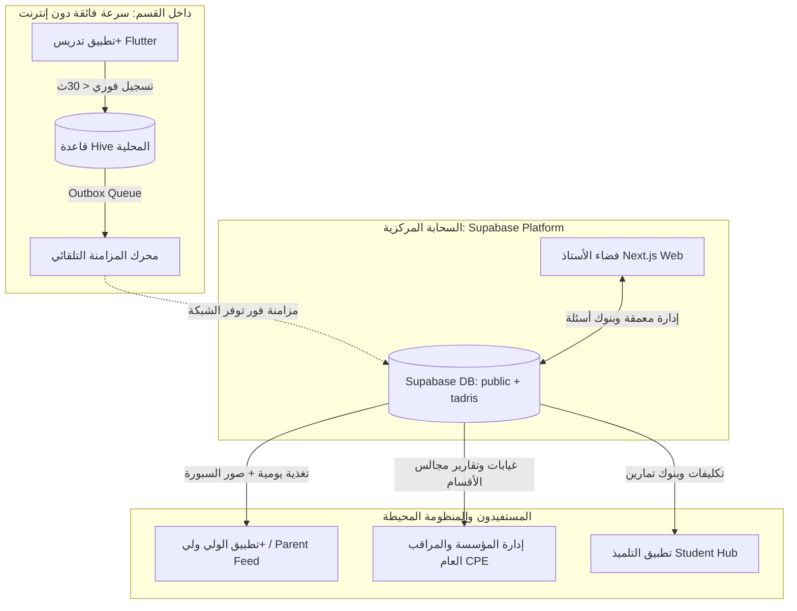
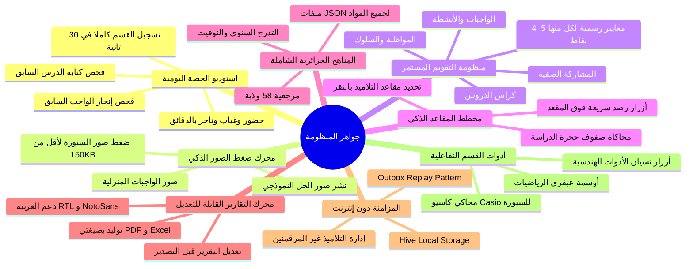
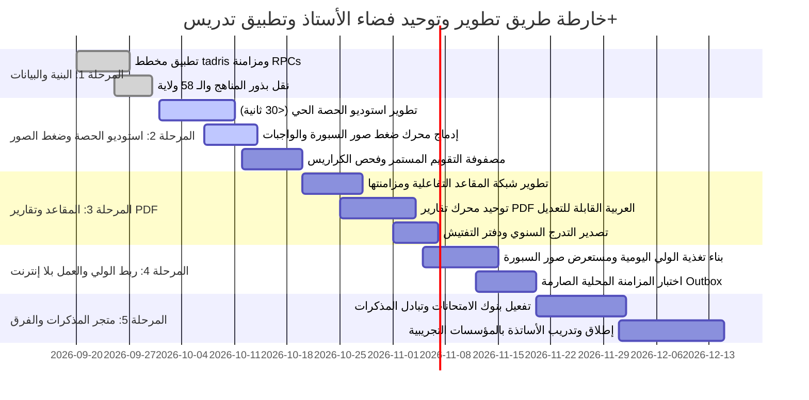

# 🎓 الدليل الهندسي الشامل: تحليل مستودع LearnPlus وخطة التطوير الموحدة لفضاء الأستاذ وتطبيق تدريس+

> **تاريخ الإعداد:** سبتمبر 2026  
> **المستودع المحلل:** `https://github.com/adaika96/LearnPlus_Nuxt.git`  
> **البيئة المرجعية:** مشروع `dz-teacher-hub` / `Math site` (تطبيق أستاذ الرياضيات - الطور المتوسط)  
> **الهدف الاستراتيجي:** استخلاص كافة نقاط القوة والحلول البرمجية من فضاء الأستاذ (`apps/teacher`) وتطبيق تدريس+ (`apps/tadrisplus`)، وتوحيدها في **خطة تطوير شاملة ومحكمة** ترتقي بالمنظومة التعليمية الجزائرية إلى أعلى المستويات العالمية.

---

## 📑 فهرس المحتويات
1. [الملخص التنفيذي والرؤية العامة للربط](#1-الملخص-التنفيذي-والرؤية-العامة)
2. [التشريح الهيكلي لمستودع LearnPlus ومجلداته](#2-التشريح-الهيكلي-لمستودع-learnplus)
3. [التحليل المعمق لفضاء الأستاذ (apps/teacher - Next.js)](#3-التحليل-المعمق-لفضاء-الأستاذ-appsteacher)
4. [التحليل المعمق لتطبيق تدريس+ (apps/tadrisplus - Flutter)](#4-التحليل-المعمق-لتطبيق-تدريس-appstadrisplus)
5. [الجواهر البرمجية المستخلصة (Core Architectural Gems)](#5-الجواهر-البرمجية-المستخلصة)
6. [مخطط قواعد البيانات الموحد (Unified Schema & RPCs)](#6-مخطط-قواعد-البيانات-الموحد)
7. [مصفوفة التكامل بين المنصات (Cross-Pollination Matrix)](#7-مصفوفة-التكامل-بين-المنصات)
8. [خطة التطوير الشاملة المجدولة (Master Phased Roadmap)](#8-خطة-التطوير-الشاملة-المجدولة)
9. [إرشادات التنفيذ ومعايير الجودة الصارمة](#9-إرشادات-التنفيذ-ومعايير-الجودة)

---

## 1. الملخص التنفيذي والرؤية العامة

يمثل مستودع **LearnPlus** حجر زاوية هندسياً عملاقاً (Monorepo يعتمد Turborepo و pnpm) يضم أكثر من 21,800 ملفاً، ويجمع بين:
1. **تطبيق الويب لفضاء الأستاذ (`apps/teacher`):** مبني بأحدث تقنيات Next.js 14 / React 19، مصمم بواجهة عربية كاملة (Direction C: الكحلي الداكن `#0b2a4a` والأزرق الملكي `#1d6fc0` مع خط Cairo والأرقام اللاتينية)، ومجهز بنظامين مستقلين للأستاذ (المتابع Mentor وصانع المحتوى Creator).
2. **تطبيق تدريس+ (`apps/tadrisplus`):** تطبيق عابر للمنصات (Flutter) مخصص للأستاذ داخل القسم، يعمل بمبدأ **دون اتصال أولاً (Offline-First)** عبر قاعدة بيانات محليه فائقة السرعة (Hive) مع مزامنة سحابية غير متزامنة (Outbox Queue) نحو Supabase، ومزود بمحرك استخراج وتعديل تقارير PDF رسمي يدعم العربية بالكامل ومخطط مقاعد تفاعلي.
3. **تطبيق أستاذ الرياضيات (`mathtracker` / `dz-teacher-hub`):** المحرك التخصصي اليومي المخصص للحصص الصفية (التقاط صور السبورة، تقويم الكراس، شبكة المقاعد في 30 ثانية، ومصفوفة التقويم المستمر الجزائرية الرسمية).

### الرؤية الموحدة: استراتيجية المحركين (Two-Engine Architecture)
بدلاً من التشتت بين مشاريع منفصلة، تقوم الاستراتيجية على **التكامل التكاملي المتناغم**:
* **الهاتف / اللوحي في القسم (تدريس+ Flutter):** للأعمال السريعة اليومية داخل الحصة (أخذ الغياب في 30 ثانية، تقويم الكراريس، تصوير السبورة، النقاط السلوكية، العمل بدون إنترنت إطلاقاً).
* **الحاسوب / الويب في المنزل أو المكتبة (فضاء الأستاذ Next.js):** للتخطيط الأسبوعي، إعداد بنوك الأسئلة، بناء الامتحانات الرسمية، متابعة التحليلات الإحصائية للنتائج، تجارة المذكرات، ومجالس الأقسام.
* **قاعدة بيانات سحابية موحدة (Supabase):** تضمن تدفق البيانات فور توفر الإنترنت لتصل لحظياً إلى تطبيق الأولياء (`wali_plus` / `parent portal`) وتطبيق المؤسسة (`school`).



---

## 2. التشريح الهيكلي لمستودع LearnPlus

يحتوي المستودع على بنية مؤسسية حديثة ومنظمة بدقة:

```
LearnPlus_Nuxt/
├── apps/
│   ├── teacher/              # فضاء الأستاذ - منصة الويب المتكاملة (Next.js 14)
│   ├── tadrisplus/           # تطبيق تدريس+ للأجهزة الذكية (Flutter Cross-Platform)
│   ├── wali_plus/            # تطبيق الولي المتطور (Flutter)
│   ├── parent/               # بوابة الولي ويب (Next.js)
│   ├── student/              # فضاء التلميذ والتعلم التفاعلي
│   ├── school/               # منصة إدارة المؤسسة والـ CPE
│   ├── arkan/                # نظام أركان التعليمي التلعيبي (Gamification)
│   ├── arkan-admin/          # لوحة إدارة تحديات وبنوك أركان
│   └── social/               # شبكة التواصل والمنتديات التعليمية
├── packages/
│   ├── supabase/             # إعدادات، أنواع وبيئة ربط Supabase الموحدة
│   ├── ui/                   # مكتبة المكونات المشتركة (Shared Design System)
│   ├── print/                # قوالب الطباعة الرسمية (Bulletins, Dossiers, Reports)
│   ├── golden-engine/        # محرك المحتوى والقواعد التربوية
│   └── arkan-tokens/         # أنظمة النقاط والأوسمة والتحفيز
├── supabase/
│   ├── migrations/           # أكثر من 100 ملف ترحيل SQL مهيكل بدقة
│   │   ├── ..._tadris_schema_scaffold.sql           # بناء مخطط tadris المستقل
│   │   ├── ..._tadris_seed_wilayas.sql               # بذور 58 ولاية ومديريات التربية
│   │   ├── ..._tadris_sessions_spine.sql            # العمود الفقري للحصص اليومية (32KB)
│   │   ├── ..._tadris_session_parent_notifications.sql # إشعارات الأولياء التلقائية
│   │   └── ..._tadris_sync_status_ensure_mentor.sql  # التحقق من اعتماد مسار الأستاذ
├── docs/
│   ├── teacher-app/          # 11 وثيقة معمارية تفصيلية لفضاء الأستاذ
│   ├── network-integration/  # 14 وثيقة استراتيجية لربط تطبيقات المنظومة
│   │   ├── 03-tadrisplus-plan.md                    # الخطة المعمارية لتدريس+
│   │   ├── 11-teacher-and-tadris-audit.md           # التدقيق التقني التكاملي
│   │   ├── 12-dz-teacher-hub-mathtracker-audit.md   # تدقيق MathTracker ونقل ميزاته
│   │   └── 13-teacher-types-vs-tadris-audit.md      # تحليل مساري المعلّم (متابع × منشئ)
└── assets/
    ├── curriculum/           # المناهج الرسمية الجزائرية لكافة الأطوار (JSON)
    └── wilaya/               # مرجعيات الـ 58 ولاية والرموز الإدارية
```

---

## 3. التحليل المعمق لفضاء الأستاذ (apps/teacher)

### 3.1 هوية النظام وفلسفة المسارين (Dual-Track System)
يعتمد فضاء الأستاذ على معمارية فريدة تفصل بذكاء بين طبيعتين لعمل الأستاذ:

| المسار | المسمى الوظيفي | الصلاحيات والوظائف الأساسية | الجداول وقواعد البيانات المعنية |
|---|---|---|---|
| **المسار الأول (A)** | **المعلّم المتابع (Mentor)** | إدارة أقسامه الحقيقية، رصد الغياب والتأخر، تقويم السلوك، متابعة الكراريس، توزيع التكليفات ومشاركتها مع الأولياء والتلاميذ | `teacher_classes`, `class_members`, `tadris.sessions`, `tadris.session_student_log`, `tadris.notebook_checks` |
| **المسار الثاني (B)** | **المعلّم المنشئ (Creator)** | تأليف الدورات والدروس النموذجية، بيع المذكرات وبنوك التمارين في المتجر، تقديم حصص المراجعة المباشرة، وتحقيق أرباح بنسبة مئوية | `courses`, `lessons`, `teacher_earnings`, `teacher_payouts`, `teacher_lesson_plan_bundles` |

### 3.2 رحلة الأستاذ والتحقق المؤسسي (Onboarding & Verification)
* **التسجيل الذكي:** الأستاذ يبدأ بملء ملفه الشخصي (المستوى الدراسي، المادة، الطور، الرتبة: أستاذ رسمي بالقطاع / أستاذ بالمدارس الخاصة / أستاذ تعليم حر + رقم الهاتف والولاية مع إمكانية رفع السيرة الذاتية CV).
* **بوابة المراجعة:** يدخل الحساب في حالة **`pending`** (مراجعة الإدارة) حيث يمكنه فقط استكشاف المناهج والمدونة، ولا يتاح له الوصول لبيانات التلاميذ الحقيقية حتى يعتمد رسمياً لضمان سلامة وحماية الأطفال (Child Safety Invariant).

### 3.3 حزمة الشاشات والمكونات المبنية فعلياً في `apps/teacher`
1. **لوحة التحكم المباشرة بالقسم (`/teacher/classes/[id]`):**
   * كشف النقاط الرسمي والمعدلات (`gradebook`).
   * التقويم الدوري والتدرج السنوي (`progression`).
   * سجل الحصص واليوميات اليومية (`sessions`).
   * إدارة الفصول الثلاثة والتقارير الفردية (`trimester` & `report`).
   * تكليف الواجبات وتصحيحها (`assignments`).
2. **استوديو التخطيط وبنوك الأسئلة (`/teacher/lesson-plans` & `question-banks`):**
   * إعداد المذكرات التربوية النموذجية بالمراحل والكفاءات المستهدفة ووضعيات الانطلاق.
   * بنك أسئلة مفهرس حسب الدروس والمستويات، ومولد امتحانات تلقائي.
3. **متجر المذكرات والأرباح (`/teacher/store` & `earnings`):**
   * تداول المذكرات وحزم الامتحانات بين الأساتذة، ومتابعة الأرباح وحسابات البريد (BaridiMob / CCP).
4. **الفرق التربوية والتواصل (`/teacher/teams` & `forums`):**
   * التنسيق التربوي بين أساتذة المادة الواحدة بالمؤسسة أو المقاطعة التفتيشية.
5. **الأداة التفاعلية: محاكي آلة حاسبة كاسيو العلمية (`CasioCalculator.tsx`):**
   * أداة رائعة تظهر على جهاز العرض (Data Show) لتدريب تلاميذ المتوسط والثانوي على استخدام الآلة الحاسبة العلمية في العمليات الحسابية والنسب المثلثية.

---

## 4. التحليل المعمق لتطبيق تدريس+ (apps/tadrisplus)

### 4.1 المعمارية التقنية (Flutter Clean Architecture)
التطبيق مبني بنمط الطبقات الصارم:
* **Core:** إدارة الحقن بالتبعية (GetIt)، الإعدادات المشتركة، مصفوفات المناهج.
* **Data:** المستودعات (Repositories) ومحركات التخزين المحلية (Hive) والسحابية (Supabase).
* **Domain:** نماذج البيانات (Models) والكيانات التربوية.
* **Presentation:** واجهات المستخدم الموزعة على حزم الميزات (Features) بدعم RTL كامل وخطوط عربية مدمجة.

### 4.2 الميزات الاستثنائية الجاهزة في `apps/tadrisplus`
1. **محرك تقارير الـ PDF فائق الدقة والقابل للتعديل (`PDFExportService` & `EditablePDFPreviewPage`):**
   * لا يكتفي بطباعة التقرير، بل يفتح شاشة معاينة تفاعلية تمكن الأستاذ من تعديل: اسم المؤسسة، اسم الأستاذ، عنوان التقرير، التاريخ، والملاحظات قبل الحفظ أو الطباعة.
   * يدعم خطوط `NotoSansArabic` المدمجة لحل مشاكل الحروف المتقطعة نهائياً.
   * يستخرج: كشوف النقاط الفردية، كشف غيابات الشهر، قوائم التلاميذ الرسمية، وجداول التدرج.
2. **مخطط مقاعد القسم التفاعلي (`seating_tab.dart`):**
   * تنظيم المقاعد كشبكة أفقية وعمودية تحاكي صفوف القسم الجزائري (صف اليمين، الوسط، اليسار).
   * سحب وإفلات التلاميذ فوق المقاعد وتلوينها بحسب مستوى التلميذ أو حالته الصحية/الانضباطية.
3. **محرك استيراد وتصدير قوائم التلاميذ (`student_io_service.dart`):**
   * استيراد فوري لقوائم التلاميذ من ملفات Excel و CSV المستخرجة من نظام الرقمنة الرسمي لوزارة التربية الوطنية.
   * معالجة ذكية للتعارضات (تحديث البيانات، دمج، أو تخطي التكرار).
4. **محرك التخطيط الزمني وتقويم الحصص (`table_calendar` + `.ics`):**
   * جدولة الحصص بتكرار أسبوعي متوافق مع جدول التوقيت الأسبوعي للأستاذ.
   * تصدير المواعيد بصيغة تقويم قياسي `.ics` لمزامنته مع تقويم Google أو الهاتف.
5. **خدمة المزامنة غير المتزامنة (`OutboxService` & `TadrisSyncService`):**
   * تسجيل كافة العمليات في صندوق محلي (Outbox) عند انقطاع الإنترنت.
   * تفريغ الصندوق تلقائياً وإعادة إرسال العمليات نحو دوال `tadris_*` في Supabase فور الاتصال.

---

## 5. الجواهر البرمجية المستخلصة (Core Architectural Gems)

من خلال فحص الأكواد المتبادلة بين `LearnPlus` و `MathTracker`، نستخلص **8 جواهر استراتيجية** يجب تثبيتها في صلب التطوير:



### 1. استوديو الحصة الحية (The Live Session Studio)
* حل لمشكلة ضيق وقت الحصة (45 إلى 60 دقيقة). الأستاذ لا يمكنه تضييع 10 دقائق في النداء وكتابة الملاحظات.
* بنقرة واحدة على صورة التلميذ في الشبكة يتم تحديد: (حاضر / غائب / متأخر مع الدقائق) + (أنجز الواجب / لم ينجز) + (كتب الدرس المنقول / لم يكتب) + نقاط المشاركة أو نسيان الأدوات.
* العملية برمتها تأخذ **أقل من 30 إلى 45 ثانية** للقسم المكون من 35 إلى 40 تلميذاً.

### 2. محرك ضغط صور السبورة والواجبات (Board & Homework Photo Engine)
* ضغط الصور مباشرة في المتصفح / الهاتف (`browser-image-compression` أو `flutter_image_compress`) لتنخفض من 4MB إلى **أقل من 150KB** مع الحفاظ الكامل على دقة كتابة الرياضيات والرموز.
* فائدة مزدوجة: توفير مساحة التخزين السحابي، وسرعة فتح الصور الفورية لأولياء الأمور حتى عبر شبكات الجيل الثالث والاتصال الضعيف.
* ميزة "نشر الحل النموذجي المصور": إتاحة حل الواجب للأولياء والتلاميذ تلقائياً فور انتهاء موعد التسليم.

### 3. حاسبة التقويم المستمر الجزائرية الرسمية (Continuous Assessment Engine)
* بناء الحساب الآلي بناءً على المنشور الوزاري الجزائري لمرحلة التعليم المتوسط:
  $$\text{علامة التقويم المستمر (20)} = \text{الانضباط والمواظبة (05)} + \text{الواجبات والأنشطة (05)} + \text{كراس الدروس (05)} + \text{المشاركة والتفاعل (05)}$$
* ثم حساب المعدل الفصلي للمادة:
  $$\text{معدل المادة} = \frac{\text{علامة التقويم المستمر} + \text{نقطة الفرض (أو معدل الفرضين)} + (\text{علامة الاختبار} \times 2)}{4}$$

### 4. دفتر التفتيش والتدرج السنوي (Inspector Dossier)
* ميزة استثنائية تخدم الأستاذ أثناء زيارة مفتش التربية الوطنية: استخراج فوري لدفتر النصوص، قائمة الغيابات المفصلة، نسب التقدم في المنهاج، والوضعيات الانطلاقية المحققة بضغطة زر وبالمعايير الوزارية الدقيقة.

### 5. دعم التلاميذ غير الحاملين لحسابات سحابية (Account-less Roster Students)
* واقع المدارس الجزائرية: ليس كل تلميذ أو ولي يملك بريداً إلكترونياً أو هاتفاً ذكياً من اليوم الأول.
* النظام يتيح إدخال القائمة بالاسم والرقم الترتيبي ومتابعتهم محلياً، مع إمكانية ربط التلميذ بحساب سحابي لاحقاً برمز انضمام (Join Code / Token) دون أي فقدان لسجل نقاطه وغياباته السابقة.

---

## 6. مخطط قواعد البيانات الموحد (Unified Schema & RPCs)

يتم تنظيم قاعدة البيانات في مساحتين رئيستين: مساحة `public` ومساحة `tadris` المعزولة والمحمية عبر دوال `SECURITY DEFINER`:

```sql
-- 1. جدول الحصص اليومية (عمود المنظومة)
CREATE TABLE IF NOT EXISTS tadris.sessions (
  id UUID PRIMARY KEY DEFAULT gen_random_uuid(),
  class_id UUID NOT NULL REFERENCES public.teacher_classes(id) ON DELETE CASCADE,
  teacher_id UUID NOT NULL REFERENCES auth.users(id) ON DELETE CASCADE,
  subject_slug TEXT DEFAULT 'mathematics',
  session_date DATE NOT NULL DEFAULT CURRENT_DATE,
  start_time TIME,
  lesson_title TEXT NOT NULL,
  explained_content TEXT,
  rough_activities TEXT,           -- كراس الأنشطة والتمارين
  lesson_summary TEXT,             -- ملخص كراس الدروس
  board_photos TEXT[] DEFAULT '{}',-- روابط صور السبورة المضغوطة
  notes TEXT,
  created_at TIMESTAMPTZ DEFAULT NOW(),
  updated_at TIMESTAMPTZ DEFAULT NOW()
);

-- 2. سجل التلميذ داخل الحصة الحية
CREATE TABLE IF NOT EXISTS tadris.session_student_log (
  id UUID PRIMARY KEY DEFAULT gen_random_uuid(),
  session_id UUID NOT NULL REFERENCES tadris.sessions(id) ON DELETE CASCADE,
  member_id UUID NOT NULL REFERENCES public.class_members(id) ON DELETE CASCADE,
  class_id UUID NOT NULL,
  teacher_id UUID NOT NULL,
  attendance TEXT CHECK (attendance IN ('present','absent_justified','absent_unjustified','late')),
  minutes_late INT DEFAULT 0,
  prev_homework TEXT CHECK (prev_homework IN ('done','partial','not_done','na')),
  prev_lesson_written BOOLEAN DEFAULT TRUE,
  missing_calculator BOOLEAN DEFAULT FALSE,
  missing_geometry BOOLEAN DEFAULT FALSE,
  missing_notebook BOOLEAN DEFAULT FALSE,
  bonus_points INT DEFAULT 0,
  behavior_note TEXT,
  created_at TIMESTAMPTZ DEFAULT NOW(),
  UNIQUE (session_id, member_id)
);

-- 3. الواجبات المنزلية المصورة والحلول النموذجية
CREATE TABLE IF NOT EXISTS tadris.session_homeworks (
  id UUID PRIMARY KEY DEFAULT gen_random_uuid(),
  session_id UUID REFERENCES tadris.sessions(id) ON DELETE SET NULL,
  class_id UUID NOT NULL REFERENCES public.teacher_classes(id) ON DELETE CASCADE,
  teacher_id UUID NOT NULL,
  description TEXT,
  photo_path TEXT,
  due_date DATE NOT NULL,
  due_time TIME,
  solution_photos TEXT[] DEFAULT '{}',
  solution_published_at TIMESTAMPTZ,
  created_at TIMESTAMPTZ DEFAULT NOW()
);

-- 4. فحص وتقويم الكراريس
CREATE TABLE IF NOT EXISTS tadris.notebook_checks (
  id UUID PRIMARY KEY DEFAULT gen_random_uuid(),
  member_id UUID NOT NULL REFERENCES public.class_members(id) ON DELETE CASCADE,
  class_id UUID NOT NULL REFERENCES public.teacher_classes(id) ON DELETE CASCADE,
  teacher_id UUID NOT NULL,
  session_id UUID REFERENCES tadris.sessions(id) ON DELETE SET NULL,
  check_date DATE NOT NULL DEFAULT CURRENT_DATE,
  status TEXT CHECK (status IN ('complete','incomplete','missing_lessons','absent_excused')),
  grade NUMERIC CHECK (grade >= 0 AND grade <= 20),
  teacher_feedback TEXT,
  lesson_confirmed BOOLEAN DEFAULT FALSE,
  created_at TIMESTAMPTZ DEFAULT NOW()
);

-- 5. مخطط مقاعد الحجرة الدراسية
CREATE TABLE IF NOT EXISTS tadris.seating_charts (
  class_id UUID PRIMARY KEY REFERENCES public.teacher_classes(id) ON DELETE CASCADE,
  teacher_id UUID NOT NULL,
  layout JSONB NOT NULL DEFAULT '{"rows": 5, "cols": 3, "grid": []}'::JSONB,
  updated_at TIMESTAMPTZ DEFAULT NOW()
);
```

---

## 7. مصفوفة التكامل بين المنصات (Cross-Pollination Matrix)

توضح هذه المصفوفة أين تتفوق كل منصة وكيف تستعير المنصة الأخرى هذه القوة لتحقيق الكمال التقني:

| الميزة الوظيفية | فضاء الأستاذ الويب (`apps/teacher`) | تطبيق تدريس+ فلاتر (`apps/tadrisplus`) | تطبيق أستاذ الرياضيات (`mathtracker`) | الإجراء الموحد في الخطة |
|---|---|---|---|---|
| **العمل دون إنترنت (Offline)** | ⚪ يتطلب اتصالاً (أو Service Worker بسيط) | 🟢 فائق القوة (قواعد Hive + Outbox) | 🟡 محلي عبر IndexedDB | **اعتماد بنية تدريس+ في فلاتر + PWA Cache للويب** |
| **سرعة الرصد الصفي (In-Class Grid)** | 🟡 نموذج كلاسيكي للغياب | 🟡 واجهة قائمة جيدة | 🟢 استوديو حي كامل في 30 ثانية مع صور السبورة | **نقل واجهة استوديو MathTracker إلى تدريس+ وفضاء الأستاذ** |
| **ضغط ورفع صور السبورة والواجبات** | ⚪ غير مدمجة | ⚪ غير مدمجة | 🟢 محرك ضغط فوري < 150KB | **إدماج محرك الضغط في التطبيقين فوراً** |
| **تقويم الكراس والتقويم المستمر** | ⚪ درجات عامة فقط | ⚪ نظام درجات تقليدي | 🟢 مصفوفة جزائرية رسمية 4×5 + علامة الكراس | **نقل حاسبة التقويم المستمر إلى تدريس+ وفضاء الويب** |
| **مخطط المقاعد التفاعلي (Seating)** | ⚪ غير متوفر | 🟢 مدمج وقابل للحفظ | 🟢 مدمج ومربوط برصد الحصة | **توحيد نموذج المقاعد في مخطط `tadris.seating_charts`** |
| **تقارير PDF احترافية قابلة للتعديل** | 🟡 قوالب طباعة HTML/CSS | 🟢 محرك PDF عربي قابل للتعديل المسبق | 🟡 قوالب JsPDF ثابتة | **اعتماد محرك تقارير تدريس+ كأساس لكافة تقارير المنظومة** |
| **التخطيط وتكرار الحصص (.ics)** | ⚪ مخطط ثابت | 🟢 يدعم التكرار والإشعارات وتصدير .ics | 🟡 تقويم شهري تفاعلي | **تفعيل تصدير المواعيد والتكرار في المنصتين** |
| **المناهج وبنوك الأسئلة والمذكرات** | 🟢 ضخمة جداً (12k درس، بنوك، دورات) | 🟡 مذكرات محلية من CSV | 🟡 تدرج سنوي للمتوسط | **ربط تدريس+ ومات تراكر ببنوك مناهج فضاء الأستاذ السحابية** |
| **بوابة الولي المباشرة والتغذية** | 🟡 موجودة في تطبيق الولي العام | ⚪ تتطلب خادم | 🟢 صفحة تغذية يومية مع تكبير صور السبورة | **اعتماد تغذية MathTracker في بوابة `wali_plus` و `parent`** |
| **محاكي آلة حاسبة كاسيو العلمية** | 🟢 مكون `CasioCalculator.tsx` | ⚪ غير متوفر | 🟢 مودال تفاعلي للسبورة | **إتاحته في الويب ودمجه كأداة عرض لأساتذة المواد العلمية** |

---

## 8. خطة التطوير الشاملة المجدولة (Master Phased Roadmap)



### 🎯 تفاصيل المراحل التنفيذية:

#### 🟢 المرحلة الأولى: توحيد البنية التحتية وقواعد البيانات (أسبوع 1 - 2)
* [ ] تطبيق حزم ترحيل SQL الخاصة بمخطط `tadris` بالكامل على Supabase.
* [ ] تفعيل أذونات الحماية وسياسات RLS ومزامنة الصلاحيات (`teacher_assert_mentor`).
* [ ] توحيد جداول الأقسام بحيث يربط المعرف الفردي مع جدول `teacher_classes` و `class_members`.
* [ ] تفعيل جداول المرجعية الإدارية: 58 ولاية جزائرية ودوائرها ومديريات التربية.

#### 🟢 المرحلة الثانية: استوديو الحصة الحية وضغط الصور (أسبوع 3 - 4)
* [ ] نقل واجهة `LiveSessionStudio` من تطبيق `MathTracker` وتضمينها كشاشة رئيسية سريعة داخل `apps/tadrisplus` (فلاتر) وفضاء الأستاذ (ويب).
* [ ] تضمين مكتبة ضغط الصور التلقائي لتقليل حجم صور السبورة فور التقاطها إلى **أقل من 150KB**.
* [ ] ربط فحص الكراريس مع خانات: (مكتمل / ناقص / دروس ناقصة / غائب معذور).
* [ ] إتاحة خيارات "الواجب المنزلي المصور" مع تاريخ التسليم وتفعيل خيار إرفاق الحل النموذجي المؤجل.

#### 🟢 المرحلة الثالثة: المقاعد وتقارير PDF والتقويم المستمر (أسبوع 5 - 6)
* [ ] توحيد ميزة مخطط المقاعد التفاعلي (Seating Chart) مع حفظ التوزيع على مستوى كل قسم.
* [ ] ربط حاسبة التقويم المستمر الجزائرية (4 × 5 = 20) بالنقاط المسجلة طيلة الفصل لتوليد المعدل الفصلي تلقائياً.
* [ ] تعميم محرك تقارير الـ PDF المعرب مع ميزة المعاينة القابلة للتعديل (`Editable Preview`) لاستخراج: كشوف النقاط، قوائم الغيابات، ودفتر يوميات الأستاذ.
* [ ] تجهيز ملف "دفتر المفتش" التلقائي ليكون جاهزاً للطباعة عند كل زيارة تفتيشية.

#### 🟢 المرحلة الرابعة: بوابة الولي والمزامنة الميدانية القوية (أسبوع 7 - 8)
* [ ] ربط شاشات الأولياء في تطبيق `wali_plus` وفي بوابة الويب مع جدول `tadris.sessions` لإظهار كروت الحصص اليومية وصور السبورة القابلة للتكبير (Pinch-to-zoom).
* [ ] تفعيل إرسال التنبيهات الفورية للأولياء في حالات: الغياب غير المبرر، التأخر بأكثر من 15 دقيقة، أو نسيان الأدوات الهندسية والحاسبة.
* [ ] إجراء اختبار المحاكاة الميداني: قطع الإنترنت عن هاتف الأستاذ، إدارة 3 حصص متتالية بالقسم بالكامل، ثم إعادة الاتصال والتأكد من وصول كافة البيانات دون أي تعارض.

#### 🟢 المرحلة الخامسة: التوسع المؤسسي ومجالس الأقسام (أسبوع 9 - 10)
* [ ] إتاحة التنسيق بين أساتذة المؤسسة الواحدة في فضاء الويب لتوحيد رزنامة الفروض والواجبات.
* [ ] ربط المنظومة مع حساب المدير والناظر والمراقب العام (CPE) في تطبيق `school` لطباعة تقرير الغيابات العام اليومي للمؤسسة بالكامل.
* [ ] تفعيل متجر المذكرات التشاركي بين الأساتذة لتبادل المذكرات النموذجية والامتحانات الموحدة.

---

## 9. إرشادات التنفيذ ومعايير الجودة الصارمة

1. **الالتزام بالهوية واللغة والأرقام:**
   * جميع الواجهات موجهة من اليمين لليسار (**RTL**) ومكتوبة بلغة عربية تربوية سليمة.
   * الالتزام التام بـ **الأرقام اللاتينية** (`0, 1, 2, 3, 4...`) في جميع كشوف النقاط والواجهات البرمجية تماشياً مع المعايير الحديثة للمناهج العلمية الجزائرية.
   * استخدام أيقونات **Lucide** وتجنب استخدام الإيموجيات العشوائية داخل الأزرار والتقارير الرسمية لضمان الطابع المؤسسي الجاد.
2. **معيار سرعة الحصة الصفية (< 30 ثانية):**
   * يجب ألا تتطلب عملية رصد غياب وسلوك وقسم كامل أكثر من نقرتين لكل تلميذ كحد أقصى، مع بقاء واجهة الإدخال نشطة حتى أثناء بطء الشبكة بفضل قاعدة Hive المحلية.
3. **أمان البيانات وخصوصية التلاميذ:**
   * تفعيل سياسات Row Level Security (RLS) الصارمة؛ لا يمكن لأي أستاذ الاطلاع على بيانات قسم أستاذ آخر إلا في حالة المشاركة المعتمدة عبر الفرق التربوية.
   * لا يمكن لأي ولي الاطلاع إلا على بيانات أبنائه المرتبطين برقم تعريفي مؤكد.
4. **ضغط الصور الفوري:**
   * تفعيل التحقق التلقائي من حجم الصورة قبل الرفع إلى سحابة Supabase Storage في باقة `tadris-materials` بحيث يرفض النظام أي صورة تتجاوز 250KB ويعيد ضغطها محلياً فوراً.

---

> 💡 **خلاصة:** إن دمج هذا الزخم الهائل من مستودع `LearnPlus_Nuxt` مع إمكانيات تطبيق أستاذ الرياضيات `MathTracker` يمنحنا منصة تعليمية جزائرية لا مثيل لها على الإطلاق، تجمع بين خفة وسرعة التطبيق الميداني في القسم وشمولية وعمق النظام المؤسسي السحابي.
